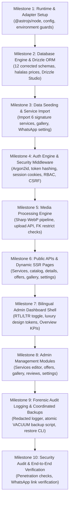

# ALOR SPA — Phase 3: Backend Architecture Audit, Technical Specification & Implementation Plan

**Project:** ALOR SPA (ألور سبا) — Luxury Women's Wellness & Massage Sanctuary, Riyadh  
**Project Path:** `S:\ALOR SPA`  
**Current Tech Stack:** Astro v7.4.5, TypeScript 5+, Tailwind CSS v4.3.4 (`@tailwindcss/vite`), Bilingual (Arabic RTL / English LTR)  
**Document Version:** 3.0.0 (Architecture Plan — Final Technical Corrections & Implementation Readiness)  
**Date:** November 2026  
**Status:** Audit & Architecture Planning Completed — Awaiting Client / Stakeholder Approval  

---

## Table of Contents

1. [Executive Summary & Architectural Objectives](#1-executive-summary--architectural-objectives)
2. [Task 1 — Existing Project Audit & Astro v7.4.5 Analysis](#2-task-1--existing-project-audit--astro-v745-analysis)
   - 2.1 Package & Dependency Audit
   - 2.2 Astro v7.4.5 Output Modes & Supported APIs
   - 2.3 Directory Structure & Asset Topology
   - 2.4 Data Models & TypeScript Types Audit
   - 2.5 Environment Variables Audit
   - 2.6 Current Static Generation (SSG) Analysis
   - 2.7 Architectural Limitations for Backend Integration
3. [Task 2 — Rendering Strategy & Route Classification](#3-task-2--rendering-strategy--route-classification)
   - 3.1 Astro Node Adapter & Output Configuration (`output: 'static'` with per-route `prerender = false`)
   - 3.2 Exact Route Classification: Dynamic vs Pre-Rendered
   - 3.3 Dynamic Service Routes Without Build-Time `getStaticPaths()`
   - 3.4 Preservation of Design, SEO, Structured Data & Bilingual Routing
   - 3.5 Rendering Strategy Comparison: SSR vs Static Shell + Client API Fetching
4. [Task 3 — Relational Database Schema Design (Corrected 12 Tables)](#4-task-3--relational-database-schema-design-corrected-12-tables)
   - 4.1 Schema Principles & Consolidation Rationale
   - 4.2 Entity Relationship Diagram (ERD)
   - 4.3 Detailed Specification of the 12 Corrected Tables
   - 4.4 Price & Duration Policy Enforcement (Halalas Monetary Storage)
   - 4.5 Media Foreign-Key Relationships & Safe Deletion Behavior
   - 4.6 Site Settings, Localization & WhatsApp Number Protection
5. [Task 4 — API Architecture & Endpoint Specification](#5-task-4--api-architecture--endpoint-specification)
   - 5.1 API Design Standards, Envelopes & Error Handling
   - 5.2 Public Client API Endpoints (Read-Only)
   - 5.3 Protected Admin API Endpoints
   - 5.4 Media Upload & Streaming API
   - 5.5 Dashboard Analytics & Statistics API
6. [Task 5 — Admin Dashboard Architecture & UX Specification](#6-task-5--admin-dashboard-architecture--ux-specification)
   - 6.1 Design System Integration (Luxury Color Palette & Typography)
   - 6.2 Information Architecture & Dashboard Sitemap
   - 6.3 Module-by-Module Functional Specifications
   - 6.4 Bilingual RTL / LTR Admin Interface Behavior
7. [Task 6 — Security Architecture & Hardening Plan](#7-task-6--security-architecture--hardening-plan)
   - 7.1 Authentication, Passwords & Session Lifecycle (Token Hashing & Expiration)
   - 7.2 Role-Based Access Control (RBAC) Matrix
   - 7.3 Input Validation & Parameter Sanitization
   - 7.4 Media Upload Security & Image Sanitization
   - 7.5 API Protection, CSRF, Rate Limiting & Security Headers
   - 7.6 Environment Variables & Git Policy
   - 7.7 Initial Super-Admin Provisioning & Local Password Reset
   - 7.8 Audit Log Redaction
8. [Task 7 — Persistent Storage, Local Development & Coordinated Backups](#8-task-7--persistent-storage-local-development--coordinated-backups)
   - 8.1 Local File & SQLite Storage Architecture
   - 8.2 SQLite WAL Shared-Memory Constraint (Network Filesystem Prohibition)
   - 8.3 Coordinated Atomic Backup Routine (Database Snapshot + Media Files)
   - 8.4 Backup Verification & Restore Testing Routine
   - 8.5 Zero-External-Dependency Local Dev Workflow
9. [Task 8 — Future Production Migration Blueprint](#9-task-8--future-production-migration-blueprint)
   - 9.1 Node.js Server Deployment Architecture
   - 9.2 Persistent vs Ephemeral Cloud Storage Handling
   - 9.3 Media Migration to S3 / Cloudflare R2
   - 9.4 HTTPS & Reverse Proxy Configuration
   - 9.5 Production Multi-Instance Rate Limiting
   - 9.6 Production Backups & Zero-Downtime Database Migrations
10. [Task 9 — Measurable Performance Targets & Testing Plan](#10-task-9--measurable-performance-targets--testing-plan)
    - 10.1 Realistic Performance Targets
    - 10.2 Structured Testing & Benchmarking Plan
11. [Task 10 — Phased Implementation Sequence & Roadmap](#11-task-10--phased-implementation-sequence--roadmap)
12. [Final Technical Decisions & Implementation Readiness](#12-final-technical-decisions--implementation-readiness)
    - 12.1 Summary of Final Decisions
    - 12.2 Implementation Milestones & Milestone Acceptance Tests
    - 12.3 Explicit Implementation Readiness Assessment
    - 12.4 Implementation Hold Notice

---

## 1. Executive Summary & Architectural Objectives

Phase 1 and Phase 2 of the ALOR SPA website delivered a luxury-branded, fully responsive bilingual (Arabic RTL default, English LTR) frontend featuring six signature wellness services, Schema.org `DaySpa` structured data, and integrated WhatsApp booking using the verified business contact (`966553543192`).

Phase 3 introduces the dynamic backend, database, authenticated admin dashboard, media management, and APIs.

### Strict Architectural Boundaries
1. **Planning Only:** Zero code changes, package installations, or database migrations will occur during this planning task.
2. **Preservation of Approved Frontend:** The existing 16 static routes, styling tokens, WhatsApp workflows, and visual components remain 100% intact.
3. **No Unapproved Business Data:** Prices and durations remain strictly editable with unconfirmed flags (`price_is_confirmed: 0`). No fake prices, hours, or addresses are introduced.
4. **100% Local Development:** All solutions run entirely on the local development machine (`S:\ALOR SPA`) without cloud subscriptions, paid databases, or live domain hosting.
5. **Production-Agnostic Design:** The storage and database architectures do not assume persistent local disks on future hosting providers.

---

## 2. Task 1 — Existing Project Audit & Astro v7.4.5 Analysis

### 2.1 Package & Dependency Audit

The project `package.json` contains:
```json
{
  "name": "alor-spa",
  "type": "module",
  "version": "0.0.1",
  "engines": {
    "node": ">=22.23.4"
  },
  "scripts": {
    "dev": "astro dev",
    "build": "astro build",
    "preview": "astro preview",
    "astro": "astro"
  },
  "dependencies": {
    "@tailwindcss/vite": "^4.3.4",
    "astro": "^7.4.5",
    "tailwindcss": "^4.3.4"
  }
}
```

* **Node Engine:** Requires Node `>=22.23.4`. Node v24.15.0 is installed locally, supporting ES Modules, native `fetch`, native `crypto`, Web Streams, and native SQLite.
* **Astro v7.4.5:** The latest major release of Astro, with Vite 6 integration and streamlined server-rendering APIs.
* **Tailwind CSS v4.3.4:** Utilizes `@tailwindcss/vite` with CSS-first design tokens in `@theme`.

---

### 2.2 Astro v7.4.5 Output Modes & Supported APIs

Inspection of Astro v7.4.5 core schema (`node_modules/astro/dist/core/config/schemas/base.js`, lines 61–65) confirms:

```javascript
output: z.union([
  z.literal("static"),
  z.literal("server"),
  z.literal("hybrid")
]).optional().default("static").refine((val) => val !== "hybrid", { 
  message: "The `output: \"hybrid\"` option has been removed. Use `output: \"static\"` (the default) instead, which now behaves the same way." 
})
```

#### Key Astro v7.4.5 Architectural Rules:
1. **`output: 'hybrid'` has been removed.** Configuring `output: 'hybrid'` will trigger a validation error at server boot.
2. **Supported Output Configurations with `@astrojs/node`:**
   - **`output: 'static'` (Recommended Standard):** Routes are pre-rendered by default. Any route or endpoint that requires on-demand execution declares:
     ```typescript
     export const prerender = false;
     ```
   - **`output: 'server'`:** Routes execute on-demand by default. Routes requiring build-time baking declare `export const prerender = true;`.

Adopting **`output: 'static'` with per-route `export const prerender = false`** provides the cleanest architectural alignment with Astro v7.4.5.

---

### 2.3 Directory Structure & Asset Topology

```
S:\ALOR SPA\
├── public\
│   ├── favicon.ico, favicon.svg
│   └── images\
│       ├── about\ (about-ambiance.jpg, about-detail.jpg)
│       ├── gallery\ (gallery-1.jpg to gallery-6.jpg)
│       ├── hero\ (hero-bg.jpg)
│       └── services\ (6 signature service images)
├── src\
│   ├── assets\ (SVG icons)
│   ├── components\
│   │   ├── layout\ (Header.astro, Footer.astro)
│   │   ├── sections\ (Hero, About, Services, Offers, Gallery, Testimonials, LocationContact)
│   │   ├── services\ (ServiceBreadcrumb, ServiceDetailContent, ServicesCatalog)
│   │   └── ui\ (Button, Card, Container, FormField, Heading, LanguageSwitcher, SectionHeader, ServiceCard, WhatsAppButton)
│   ├── config\ (site.ts)
│   ├── data\ (services.ts, offers.ts, gallery.ts, testimonials.ts)
│   ├── i18n\ (translations.ts, utils.ts)
│   ├── layouts\ (Layout.astro)
│   ├── pages\
│   │   ├── index.astro (Arabic Home)
│   │   ├── services\
│   │   │   ├── index.astro (Arabic Catalog)
│   │   │   └── [slug].astro (Arabic Service Details)
│   │   └── en\
│   │       ├── index.astro (English Home)
│   │       └── services\
│   │           ├── index.astro (English Catalog)
│   │           └── [slug].astro (English Service Details)
│   └── styles\ (global.css — 860 lines containing Tailwind v4 design tokens)
├── .env.example
├── astro.config.mjs
├── package.json
└── tsconfig.json
```

---

### 2.4 Data Models & TypeScript Types Audit

All business entities currently reside in static TypeScript files:
1. `src/config/site.ts`: Defines `BusinessConfig`, Riyadh coordinates, phone/WhatsApp normalization, and booking link generation.
2. `src/data/services.ts`: Defines `ServiceItem`, `ServicePrice`, `ServiceDuration`, `ServiceStep`. Contains 6 signature services.
3. `src/data/offers.ts`: `activeOffers = []` (Empty to avoid fake promotions).
4. `src/data/gallery.ts`: 6 entries categorized into `treatment`, `ambiance`, and `rituals`.
5. `src/data/testimonials.ts`: `verifiedTestimonials = []` (Empty to avoid fake reviews).

---

### 2.5 Environment Variables Audit

- Current `.env`:
  ```env
  PUBLIC_WHATSAPP_NUMBER=966553543192
  ```
- All variables currently have the `PUBLIC_` prefix, meaning they are exposed to the client bundle. Backend secrets must be private and strictly server-accessible.

---

### 2.6 Current Static Generation (SSG) Analysis

Running `astro build` currently produces 16 static HTML pages:
- Arabic Home (`/index.html`)
- English Home (`/en/index.html`)
- Arabic Services Index (`/services/index.html`)
- English Services Index (`/en/services/index.html`)
- 6 Arabic Service Detail Pages (`/services/[slug]/index.html`)
- 6 English Service Detail Pages (`/en/services/[slug]/index.html`)

Dynamic routing currently uses `getStaticPaths()` reading directly from hardcoded TypeScript arrays.

---

### 2.7 Architectural Limitations for Backend Integration

| Area | Current Static State | Limitation for Dynamic Backend | Required Architectural Evolution |
| :--- | :--- | :--- | :--- |
| **Runtime Execution** | `output: 'static'` (HTML files) | Cannot handle `POST/PUT/DELETE`, session cookies, or dynamic database queries. | Add `@astrojs/node` adapter with on-demand SSR capability. |
| **Content Updates** | Hardcoded `.ts` data files | Content edits require code modification, git commits, and full site rebuilds. | Relational database (SQLite/LibSQL) with Drizzle ORM. |
| **Authentication** | None | No session verification, HTTP-only cookies, or admin authorization. | Server-side cryptographic session engine. |
| **Media Management** | Static files in `/public/images/` | No file upload pipeline, validation, resizing, or dynamic WebP compression. | Local disk upload engine with Sharp optimization and database metadata registry. |
| **Security Boundaries** | All variables prefixed with `PUBLIC_` | Secret keys or DB credentials cannot be safely declared. | Strict separation of private server env variables and public client env variables. |

---

## 3. Task 2 — Rendering Strategy & Route Classification

### 3.1 Astro Node Adapter & Output Configuration

The project will configure Astro v7.4.5 using `@astrojs/node` in `astro.config.mjs`:

```javascript
import { defineConfig } from 'astro/config';
import node from '@astrojs/node';
import tailwindcss from '@tailwindcss/vite';

export default defineConfig({
  site: 'https://alorspa.com',
  output: 'static', // Astro v7.4.5 default: static pre-rendering by default
  adapter: node({
    mode: 'standalone',
  }),
  i18n: {
    defaultLocale: 'ar',
    locales: ['ar', 'en'],
    routing: {
      prefixDefaultLocale: false,
    },
  },
  vite: {
    plugins: [tailwindcss()],
  },
});
```

Routes requiring dynamic database queries declare:
```typescript
export const prerender = false;
```

---

### 3.2 Exact Route Classification: Dynamic vs Pre-Rendered

To ensure admin dashboard updates immediately reflect across the website without rebuilds, routes are classified as follows:

| Route Path | Source File | Rendering Mode | Rationale |
| :--- | :--- | :--- | :--- |
| **`/` (Arabic Home)** | `src/pages/index.astro` | Dynamic (`prerender = false`) | Reads hero text, featured offers, gallery items, reviews, and site settings directly from the database. |
| **`/en/` (English Home)** | `src/pages/en/index.astro` | Dynamic (`prerender = false`) | Reads English hero text, offers, gallery, reviews, and settings from the database. |
| **`/services` (Arabic Catalog)** | `src/pages/services/index.astro` | Dynamic (`prerender = false`) | Displays active services, catalog order, confirmed price flags, and category filters dynamically. |
| **`/en/services` (English Catalog)** | `src/pages/en/services/index.astro` | Dynamic (`prerender = false`) | Displays English service catalog dynamically. |
| **`/services/[slug]` (Arabic Details)**| `src/pages/services/[slug].astro` | Dynamic (`prerender = false`) | Reads full service details, features, benefits, steps, and SEO metadata on-demand. |
| **`/en/services/[slug]` (English Details)**| `src/pages/en/services/[slug].astro` | Dynamic (`prerender = false`) | Reads full English service details on-demand. |
| **`/blog` & `/blog/[slug]`** | Future blog routes | Dynamic (`prerender = false`) | New articles, publication states, and SEO meta update immediately upon publish. |
| **`/api/v1/*`** | All API routes | Dynamic (`prerender = false`) | REST endpoints must process runtime HTTP requests and mutations. |
| **`/admin/*`** | All admin dashboard routes | Dynamic (`prerender = false`) | Authenticated session checking and interactive administrative views. |
| **`/404`** | `src/pages/404.astro` | **Pre-rendered (`prerender = true`)** | Static error page requiring no database access. |
| **Favicons, Robots, Sitemaps** | Static files / generator | **Pre-rendered** | Static public assets. |

---

### 3.3 Dynamic Service Routes Without Build-Time `getStaticPaths()`

In static mode, dynamic routes (`[slug].astro`) require `getStaticPaths()` to enumerate pages at build time. When a route declares `export const prerender = false;`, **Astro disables `getStaticPaths()`** and executes the route handler at request time.

#### Runtime Dynamic Route Handler Pattern:
```typescript
---
// src/pages/services/[slug].astro
export const prerender = false;

import Layout from '../../layouts/Layout.astro';
import Header from '../../components/layout/Header.astro';
import Footer from '../../components/layout/Footer.astro';
import ServiceDetailContent from '../../components/services/ServiceDetailContent.astro';
import { db } from '../../server/db';
import { services } from '../../server/db/schema';
import { eq, and } from 'drizzle-orm';

const { slug } = Astro.params;

if (!slug) {
  Astro.response.status = 404;
  return Astro.rewrite('/404');
}

// Query service record on-demand from SQLite (sub-millisecond execution)
const service = await db.query.services.findFirst({
  where: and(eq(services.slug, slug), eq(services.is_published, 1)),
  with: {
    featuredImage: true,
    category: true,
  },
});

if (!service) {
  // Enforce genuine HTTP 404 status code (never return HTTP 200 for missing resources)
  Astro.response.status = 404;
  return Astro.rewrite('/404');
}

const siteUrl = Astro.site?.toString() || 'https://alorspa.com';
const currentPath = `/services/${service.slug}`;
const alternatePath = `/en/services/${service.slug}`;
---

<Layout
  title={service.seo_title_ar || service.title_ar}
  description={service.seo_description_ar || service.description_ar}
  canonicalPath={currentPath}
  alternatePath={alternatePath}
>
  <Header />
  <main id="main-content">
    <ServiceDetailContent service={service} />
  </main>
  <Footer />
</Layout>
```

---

### 3.4 Preservation of Design, SEO, Structured Data & Bilingual Routing

Transitioning to dynamic rendering preserves 100% of the approved Phase 1 & 2 assets:
1. **Design & Styling:** All Tailwind v4 tokens, luxury colors (Chocolate Brown `#38251F`, Warm Ivory `#F5EFE5`, Champagne `#D8C4A3`, Bronze `#A87952`), and typography remain identical.
2. **Canonical URLs & Hreflang:** Canonical links and alternate tags (`hreflang="ar"`, `hreflang="en"`, `hreflang="x-default"`) are rendered in HTML before transmission.
3. **Structured Data:** Schema.org `Service`, `DaySpa`, and `BreadcrumbList` JSON-LD scripts are embedded in the server response with dynamic, database-driven service names.
4. **Bilingual URLs:** Preserves root Arabic routes (`/services/:slug`) and English routes (`/en/services/:slug`).

---

### 3.5 Rendering Strategy Comparison: SSR vs Static Shell + Client API Fetching

| Evaluation Dimension | Approach A: On-Demand SSR (`prerender = false`) | Approach B: Static Pages + Client API Fetching |
| :--- | :--- | :--- |
| **SEO & Crawler Parsing** | **Optimal.** Crawlers receive complete HTML containing all texts, headings, and Schema.org metadata in the initial TCP response. | **Deficient.** Crawlers that do not execute client JS (WhatsApp scrapers, Twitterbot) receive empty shells or stale data. |
| **Admin Update Immediacy** | **Instant.** Changes saved in the admin dashboard appear on the next HTTP request. Zero rebuild needed. | **Instant for JS browsers, stale for bots.** |
| **Layout Shift (CLS)** | **Zero.** The browser renders complete HTML on first paint. | **Flicker Risk.** Layout shifts when client JS replaces placeholder elements with fetched API data. |
| **Code Maintenance** | **Minimal.** Leverages existing Astro component architecture without rewriting. | **High.** Requires building client-side data fetchers and reactive state managers for every section. |

---

## 4. Task 3 — Relational Database Schema Design (Corrected 12 Tables)

### 4.1 Schema Principles & Consolidation Rationale

The database schema is consolidated into **exactly 12 tables**:
1. `admin_roles` (Permissions stored as JSON array — eliminates 2 redundant join tables).
2. `admin_users`
3. `admin_sessions` (Stores SHA-256 `token_hash`, `created_at`, `last_activity_at`, `expires_at`, `revoked_at`).
4. `service_categories`
5. `services` (Bilingual fields, integer halalas monetary storage, foreign-key image links).
6. `offers` (Integer halalas monetary storage, validity timestamps, unconfirmed price guard).
7. `gallery_items` (Foreign-key image link to `media_files`, display order).
8. `reviews` (`is_verified` defaults to `0`, `is_approved` defaults to `0`).
9. `blog_posts` (Bilingual articles, foreign-key cover image).
10. `site_settings` (Consolidated key-value store for business identity, WhatsApp, and homepage copy blocks).
11. `media_files` (Registry of assets with dimensions and accessibility alt text).
12. `activity_logs` (Forensic audit trail with sensitive data redaction).

---

### 4.2 Entity Relationship Diagram (ERD)

```mermaid
erDiagram
    ADMIN_ROLES ||--o{ ADMIN_USERS : "assigned_to"
    ADMIN_USERS ||--o{ ADMIN_SESSIONS : "holds"
    ADMIN_USERS ||--o{ ACTIVITY_LOGS : "performs"
    ADMIN_USERS ||--o{ MEDIA_FILES : "uploads"

    SERVICE_CATEGORIES ||--o{ SERVICES : "classifies"
    SERVICES ||--o{ REVIEWS : "receives"
    MEDIA_FILES ||--o{ SERVICES : "featured_image"
    MEDIA_FILES ||--o{ OFFERS : "banner_image"
    MEDIA_FILES ||--o{ GALLERY_ITEMS : "media_asset"
    MEDIA_FILES ||--o{ BLOG_POSTS : "thumbnail"

    ADMIN_ROLES {
        string id PK
        string slug
        string name_ar
        string name_en
        string description
        json permissions
        integer created_at
    }

    ADMIN_USERS {
        string id PK
        string role_id FK
        string username
        string email
        string password_hash
        string full_name
        boolean is_active
        integer last_login_at
        integer created_at
        integer updated_at
    }

    ADMIN_SESSIONS {
        string id PK
        string user_id FK
        string token_hash
        string ip_address
        string user_agent
        integer created_at
        integer last_activity_at
        integer expires_at
        integer revoked_at
    }

    SERVICE_CATEGORIES {
        string id PK
        string slug
        string title_ar
        string title_en
        integer display_order
        boolean is_active
    }

    SERVICES {
        string id PK
        string category_id FK
        string featured_image_id FK
        string slug
        string title_ar
        string title_en
        string subtitle_ar
        string subtitle_en
        string description_ar
        string description_en
        json detailed_description_ar
        json detailed_description_en
        boolean is_signature
        boolean is_published
        integer display_order
        integer price_amount_halalas
        string price_currency
        boolean price_is_confirmed
        string price_display_ar
        string price_display_en
        string price_note_ar
        string price_note_en
        integer duration_minutes
        boolean duration_is_confirmed
        string duration_display_ar
        string duration_display_en
        string duration_note_ar
        string duration_note_en
        json features_ar
        json features_en
        json benefits_ar
        json benefits_en
        json steps_ar
        json steps_en
        json includes_ar
        json includes_en
        string suitability_ar
        string suitability_en
        string advisory_ar
        string advisory_en
        string seo_title_ar
        string seo_title_en
        string seo_description_ar
        string seo_description_en
        integer created_at
        integer updated_at
    }

    OFFERS {
        string id PK
        string slug
        string image_id FK
        string badge_ar
        string badge_en
        string title_ar
        string title_en
        string subtitle_ar
        string subtitle_en
        string description_ar
        string description_en
        json includes_ar
        json includes_en
        integer price_amount_halalas
        string price_currency
        boolean price_is_confirmed
        string price_display_ar
        string price_display_en
        integer duration_minutes
        boolean duration_is_confirmed
        string duration_display_ar
        string duration_display_en
        boolean is_featured
        boolean is_active
        integer starts_at
        integer expires_at
        integer display_order
        integer created_at
        integer updated_at
    }

    GALLERY_ITEMS {
        string id PK
        string media_id FK
        string category
        string category_label_ar
        string category_label_en
        string title_ar
        string title_en
        string alt_ar
        string alt_en
        integer display_order
        boolean is_published
        integer created_at
        integer updated_at
    }

    REVIEWS {
        string id PK
        string service_id FK
        string author_name
        string author_title_ar
        string author_title_en
        string quote_ar
        string quote_en
        integer rating
        boolean is_verified
        boolean is_approved
        integer display_order
        integer review_date
        integer created_at
        integer updated_at
    }

    BLOG_POSTS {
        string id PK
        string slug
        string featured_image_id FK
        string title_ar
        string title_en
        string excerpt_ar
        string excerpt_en
        string content_ar
        string content_en
        string author_name
        boolean is_published
        integer published_at
        string seo_title_ar
        string seo_title_en
        string seo_desc_ar
        string seo_desc_en
        integer created_at
        integer updated_at
    }

    SITE_SETTINGS {
        string key PK
        string value_ar
        string value_en
        string value_raw
        string group_name
        string data_type
        boolean is_public
        boolean is_immutable
        integer updated_at
    }

    MEDIA_FILES {
        string id PK
        string filename
        string original_name
        string mime_type
        integer file_size
        integer width
        integer height
        string storage_path
        string public_url
        string alt_ar
        string alt_en
        string title_ar
        string title_en
        string uploaded_by FK
        integer created_at
        integer updated_at
    }

    ACTIVITY_LOGS {
        string id PK
        string user_id FK
        string action
        string entity_type
        string entity_id
        json old_values
        json new_values
        string ip_address
        string user_agent
        integer created_at
    }
```



---

### 4.3 Detailed Specification of the 12 Corrected Tables

#### Table 1: `admin_roles`
* **Purpose:** Defines administrative roles and granular permission sets.
* **Fields & Types:**
  - `id`: `TEXT PRIMARY KEY` (e.g. `'role_super_admin'`, `'role_spa_manager'`, `'role_content_editor'`)
  - `slug`: `TEXT NOT NULL UNIQUE` (`super_admin`, `spa_manager`, `content_editor`)
  - `name_ar`: `TEXT NOT NULL`
  - `name_en`: `TEXT NOT NULL`
  - `description`: `TEXT`
  - `permissions`: `TEXT (JSON) NOT NULL` (JSON array of permission strings)
  - `created_at`: `INTEGER NOT NULL`
* **Indexes:** `idx_admin_roles_slug` ON (`slug`)

---

#### Table 2: `admin_users`
* **Purpose:** Stores administrator accounts and Argon2id password hashes.
* **Fields & Types:**
  - `id`: `TEXT PRIMARY KEY` (UUID)
  - `role_id`: `TEXT NOT NULL REFERENCES admin_roles(id) ON DELETE RESTRICT`
  - `username`: `TEXT NOT NULL UNIQUE`
  - `email`: `TEXT NOT NULL UNIQUE`
  - `password_hash`: `TEXT NOT NULL` (Argon2id)
  - `full_name`: `TEXT NOT NULL`
  - `is_active`: `INTEGER NOT NULL DEFAULT 1`
  - `last_login_at`: `INTEGER`
  - `created_at`: `INTEGER NOT NULL`
  - `updated_at`: `INTEGER NOT NULL`
* **Indexes:** `idx_admin_users_username`, `idx_admin_users_email`, `idx_admin_users_role_id`

---

#### Table 3: `admin_sessions`
* **Purpose:** Tracks authenticated server-side sessions with SHA-256 token hashing and dual expiration.
* **Fields & Types:**
  - `id`: `TEXT PRIMARY KEY` (UUID)
  - `user_id`: `TEXT NOT NULL REFERENCES admin_users(id) ON DELETE CASCADE`
  - `token_hash`: `TEXT NOT NULL UNIQUE` (SHA-256 hash of random session token)
  - `ip_address`: `TEXT`
  - `user_agent`: `TEXT`
  - `created_at`: `INTEGER NOT NULL`
  - `last_activity_at`: `INTEGER NOT NULL`
  - `expires_at`: `INTEGER NOT NULL` (Absolute expiration: 7 days)
  - `revoked_at`: `INTEGER NULL` (Timestamp when manually invalidated)
* **Session Invalidation Rules:**
  A session is invalid if:
  1. `now > expires_at` (Absolute 7-day expiration exceeded), OR
  2. `now - last_activity_at > 86,400,000` (Idle 24-hour timeout exceeded), OR
  3. `revoked_at IS NOT NULL` (Explicit logout or admin revocation).
* **Indexes:** `idx_admin_sessions_token_hash`, `idx_admin_sessions_user_id`, `idx_admin_sessions_expires_at`

---

#### Table 4: `service_categories`
* **Purpose:** Organizes treatments into categories (`massage`, `bath`, `beauty`, `wellness`).
* **Fields & Types:**
  - `id`: `TEXT PRIMARY KEY` (`'cat_massage'`, `'cat_bath'`, `'cat_beauty'`, `'cat_wellness'`)
  - `slug`: `TEXT NOT NULL UNIQUE`
  - `title_ar`: `TEXT NOT NULL`, `title_en`: `TEXT NOT NULL`
  - `display_order`: `INTEGER NOT NULL DEFAULT 0`
  - `is_active`: `INTEGER NOT NULL DEFAULT 1`
* **Indexes:** `idx_service_categories_slug` ON (`slug`)

---

#### Table 5: `services`
* **Purpose:** Stores the 6 signature services with bilingual parity, integer monetary storage, and foreign-key media links.
* **Fields & Types:**
  - `id`: `TEXT PRIMARY KEY` (`'relaxation-massage'`, etc.)
  - `category_id`: `TEXT NOT NULL REFERENCES service_categories(id) ON DELETE RESTRICT`
  - `featured_image_id`: `TEXT REFERENCES media_files(id) ON DELETE RESTRICT`
  - `slug`: `TEXT NOT NULL UNIQUE`
  - `title_ar`: `TEXT NOT NULL`, `title_en`: `TEXT NOT NULL`
  - `subtitle_ar`: `TEXT NOT NULL`, `subtitle_en`: `TEXT NOT NULL`
  - `description_ar`: `TEXT NOT NULL`, `description_en`: `TEXT NOT NULL`
  - `detailed_description_ar`: `TEXT (JSON) NOT NULL` (Array of paragraphs)
  - `detailed_description_en`: `TEXT (JSON) NOT NULL`
  - `is_signature`: `INTEGER NOT NULL DEFAULT 0`
  - `is_published`: `INTEGER NOT NULL DEFAULT 1`
  - `display_order`: `INTEGER NOT NULL DEFAULT 0`
  - **Monetary Storage (Smallest Unit):**
    - `price_amount_halalas`: `INTEGER NULL` (Nullable integer: e.g. 150.00 SAR = `15000` halalas. Storing currency as integers eliminates SQLite `REAL` floating-point rounding errors.)
    - `price_currency`: `TEXT NOT NULL DEFAULT 'SAR'`
    - `price_is_confirmed`: `INTEGER NOT NULL DEFAULT 0` (0 = Upon Inquiry)
    - `price_display_ar`: `TEXT NOT NULL DEFAULT 'الأسعار عند الاستفسار'`
    - `price_display_en`: `TEXT NOT NULL DEFAULT 'Price on inquiry'`
    - `price_note_ar`: `TEXT`, `price_note_en`: `TEXT`
  - **Duration Storage:**
    - `duration_minutes`: `INTEGER NULL`
    - `duration_is_confirmed`: `INTEGER NOT NULL DEFAULT 0` (0 = Confirmed upon booking)
    - `duration_display_ar`: `TEXT NOT NULL DEFAULT 'تحدد عند الحجز'`
    - `duration_display_en`: `TEXT NOT NULL DEFAULT 'Confirmed upon booking'`
    - `duration_note_ar`: `TEXT`, `duration_note_en`: `TEXT`
  - **Bilingual Content Arrays:**
    - `features_ar`: `TEXT (JSON) NOT NULL`, `features_en`: `TEXT (JSON) NOT NULL`
    - `benefits_ar`: `TEXT (JSON) NOT NULL`, `benefits_en`: `TEXT (JSON) NOT NULL`
    - `steps_ar`: `TEXT (JSON) NOT NULL`, `steps_en`: `TEXT (JSON) NOT NULL`
    - `includes_ar`: `TEXT (JSON) NOT NULL`, `includes_en`: `TEXT (JSON) NOT NULL`
  - **Advisory & Suitability:**
    - `suitability_ar`: `TEXT NOT NULL`, `suitability_en`: `TEXT NOT NULL`
    - `advisory_ar`: `TEXT NOT NULL`, `advisory_en`: `TEXT NOT NULL`
  - **SEO Metadata:**
    - `seo_title_ar`: `TEXT NOT NULL`, `seo_title_en`: `TEXT NOT NULL`
    - `seo_description_ar`: `TEXT NOT NULL`, `seo_description_en`: `TEXT NOT NULL`
  - `created_at`: `INTEGER NOT NULL`, `updated_at`: `INTEGER NOT NULL`
* **Indexes:** `idx_services_slug`, `idx_services_category_id`, `idx_services_published_order`

---

#### Table 6: `offers`
* **Purpose:** Stores promotional packages, seasonal specials, and VIP bundles.
* **Fields & Types:**
  - `id`: `TEXT PRIMARY KEY` (UUID)
  - `slug`: `TEXT NOT NULL UNIQUE`
  - `image_id`: `TEXT REFERENCES media_files(id) ON DELETE RESTRICT`
  - `badge_ar`: `TEXT`, `badge_en`: `TEXT`
  - `title_ar`: `TEXT NOT NULL`, `title_en`: `TEXT NOT NULL`
  - `subtitle_ar`: `TEXT NOT NULL`, `subtitle_en`: `TEXT NOT NULL`
  - `description_ar`: `TEXT NOT NULL`, `description_en`: `TEXT NOT NULL`
  - `includes_ar`: `TEXT (JSON) NOT NULL`, `includes_en`: `TEXT (JSON) NOT NULL`
  - **Pricing & Validity:**
    - `price_amount_halalas`: `INTEGER NULL` (Nullable integer in halalas)
    - `price_currency`: `TEXT NOT NULL DEFAULT 'SAR'`
    - `price_is_confirmed`: `INTEGER NOT NULL DEFAULT 0` (0 = Upon Inquiry)
    - `price_display_ar`: `TEXT NOT NULL DEFAULT 'الأسعار عند الاستفسار'`
    - `price_display_en`: `TEXT NOT NULL DEFAULT 'Price on inquiry'`
    - `duration_minutes`: `INTEGER NULL`
    - `duration_is_confirmed`: `INTEGER NOT NULL DEFAULT 0`
    - `duration_display_ar`: `TEXT NOT NULL DEFAULT 'تحدد عند الحجز'`
    - `duration_display_en`: `TEXT NOT NULL DEFAULT 'Confirmed upon booking'`
    - `starts_at`: `INTEGER NULL`, `expires_at`: `INTEGER NULL`
  - `is_featured`: `INTEGER NOT NULL DEFAULT 0`
  - `is_active`: `INTEGER NOT NULL DEFAULT 0`
  - `display_order`: `INTEGER NOT NULL DEFAULT 0`
  - `created_at`: `INTEGER NOT NULL`, `updated_at`: `INTEGER NOT NULL`
* **Indexes:** `idx_offers_active` ON (`is_active`, `display_order`)

---

#### Table 7: `gallery_items`
* **Purpose:** Manages sanctuary photography linked via foreign keys to `media_files`.
* **Fields & Types:**
  - `id`: `TEXT PRIMARY KEY` (UUID)
  - `media_id`: `TEXT NOT NULL REFERENCES media_files(id) ON DELETE RESTRICT`
  - `category`: `TEXT NOT NULL` (`'ambiance'`, `'treatment'`, `'rituals'`)
  - `category_label_ar`: `TEXT NOT NULL`, `category_label_en`: `TEXT NOT NULL`
  - `title_ar`: `TEXT NOT NULL`, `title_en`: `TEXT NOT NULL`
  - `alt_ar`: `TEXT NOT NULL`, `alt_en`: `TEXT NOT NULL`
  - `display_order`: `INTEGER NOT NULL DEFAULT 0`
  - `is_published`: `INTEGER NOT NULL DEFAULT 1`
  - `created_at`: `INTEGER NOT NULL`, `updated_at`: `INTEGER NOT NULL`
* **Indexes:** `idx_gallery_category` ON (`category`, `display_order`)

---

#### Table 8: `reviews`
* **Purpose:** Verified client feedback. Guarantees no fake reviews are published or verified by default.
* **Fields & Types:**
  - `id`: `TEXT PRIMARY KEY` (UUID)
  - `service_id`: `TEXT REFERENCES services(id) ON DELETE SET NULL`
  - `author_name`: `TEXT NOT NULL`
  - `author_title_ar`: `TEXT`, `author_title_en`: `TEXT`
  - `quote_ar`: `TEXT NOT NULL`, `quote_en`: `TEXT NOT NULL`
  - `rating`: `INTEGER NOT NULL DEFAULT 5`
  - `is_verified`: `INTEGER NOT NULL DEFAULT 0` (0 by default; only set to 1 with verified booking evidence)
  - `is_approved`: `INTEGER NOT NULL DEFAULT 0` (0 by default; admin must approve)
  - `display_order`: `INTEGER NOT NULL DEFAULT 0`
  - `review_date`: `INTEGER NOT NULL`
  - `created_at`: `INTEGER NOT NULL`, `updated_at`: `INTEGER NOT NULL`
* **Indexes:** `idx_reviews_approved` ON (`is_approved`, `display_order`)

---

#### Table 9: `blog_posts`
* **Purpose:** Spa guides and SEO articles.
* **Fields & Types:**
  - `id`: `TEXT PRIMARY KEY` (UUID)
  - `slug`: `TEXT NOT NULL UNIQUE`
  - `featured_image_id`: `TEXT REFERENCES media_files(id) ON DELETE RESTRICT`
  - `title_ar`: `TEXT NOT NULL`, `title_en`: `TEXT NOT NULL`
  - `excerpt_ar`: `TEXT NOT NULL`, `excerpt_en`: `TEXT NOT NULL`
  - `content_ar`: `TEXT NOT NULL`, `content_en`: `TEXT NOT NULL`
  - `author_name`: `TEXT NOT NULL DEFAULT 'ALOR SPA'`
  - `is_published`: `INTEGER NOT NULL DEFAULT 0`
  - `published_at`: `INTEGER`
  - `seo_title_ar`: `TEXT`, `seo_title_en`: `TEXT`
  - `seo_desc_ar`: `TEXT`, `seo_desc_en`: `TEXT`
  - `created_at`: `INTEGER NOT NULL`, `updated_at`: `INTEGER NOT NULL`
* **Indexes:** `idx_blog_posts_slug`, `idx_blog_posts_published`

---

#### Table 10: `site_settings`
* **Purpose:** Consolidates business configuration, official WhatsApp booking number, and homepage text blocks.
* **Fields & Types:**
  - `key`: `TEXT PRIMARY KEY` (e.g. `'contact.whatsapp'`, `'homepage.hero_title'`)
  - `value_ar`: `TEXT NOT NULL` (Arabic text or localized value)
  - `value_en`: `TEXT NOT NULL` (English text or localized value)
  - `value_raw`: `TEXT NULL` (Canonical non-localized value: e.g. phone number, coordinates)
  - `group_name`: `TEXT NOT NULL` (`'contact'`, `'social'`, `'hours'`, `'homepage'`, `'about'`)
  - `data_type`: `TEXT NOT NULL DEFAULT 'string'` (`'string'`, `'number'`, `'boolean'`, `'json'`)
  - `is_public`: `INTEGER NOT NULL DEFAULT 1` (Safe for public client consumption)
  - `is_immutable`: `INTEGER NOT NULL DEFAULT 0` (1 prevents deletion or modification without Super Admin confirmation)
  - `updated_at`: `INTEGER NOT NULL`
* **Indexes:** `idx_site_settings_group` ON (`group_name`, `is_public`)

---

#### Table 11: `media_files`
* **Purpose:** Master registry of uploaded assets, physical paths, dimensions, and bilingual accessibility metadata.
* **Fields & Types:**
  - `id`: `TEXT PRIMARY KEY` (UUID)
  - `filename`: `TEXT NOT NULL` (e.g. `c4b1...webp`)
  - `original_name`: `TEXT NOT NULL`
  - `mime_type`: `TEXT NOT NULL` (`image/webp`, `image/jpeg`, etc.)
  - `file_size`: `INTEGER NOT NULL` (bytes)
  - `width`: `INTEGER`, `height`: `INTEGER`
  - `storage_path`: `TEXT NOT NULL` (Relative disk path or S3 key)
  - `public_url`: `TEXT NOT NULL`
  - `alt_ar`: `TEXT NOT NULL DEFAULT ''`, `alt_en`: `TEXT NOT NULL DEFAULT ''`
  - `title_ar`: `TEXT`, `title_en`: `TEXT`
  - `uploaded_by`: `TEXT REFERENCES admin_users(id) ON DELETE SET NULL`
  - `created_at`: `INTEGER NOT NULL`, `updated_at`: `INTEGER NOT NULL`
* **Indexes:** `idx_media_files_created` ON (`created_at`)

---

#### Table 12: `activity_logs`
* **Purpose:** Immutable forensic audit trail recording administrative operations with sensitive field redaction.
* **Fields & Types:**
  - `id`: `TEXT PRIMARY KEY` (UUID)
  - `user_id`: `TEXT REFERENCES admin_users(id) ON DELETE SET NULL`
  - `action`: `TEXT NOT NULL` (`'CREATE'`, `'UPDATE'`, `'DELETE'`, `'LOGIN'`, `'LOGOUT'`)
  - `entity_type`: `TEXT NOT NULL` (`'SERVICE'`, `'OFFER'`, `'GALLERY'`, `'REVIEW'`, `'SETTINGS'`)
  - `entity_id`: `TEXT`
  - `old_values`: `TEXT (JSON)` (Redacted snapshot)
  - `new_values`: `TEXT (JSON)` (Redacted snapshot)
  - `ip_address`: `TEXT`
  - `user_agent`: `TEXT`
  - `created_at`: `INTEGER NOT NULL`
* **Indexes:** `idx_activity_logs_created`, `idx_activity_logs_user`, `idx_activity_logs_entity`

---

### 4.4 Price & Duration Policy Enforcement (Halalas Monetary Storage)

1. **Halalas Storage:** Prices are stored as `INTEGER` representing the smallest currency unit (100 halalas = 1 SAR). For example, 150.00 SAR is stored as `15000`. This completely avoids SQLite floating-point inaccuracies.
2. **Strict Public Visibility Guard:**
   - On public pages and public APIs, if `price_is_confirmed === 0`, `price_amount_halalas` is stripped from the response and never rendered. The frontend strictly displays `price_display_ar` ("الأسعار عند الاستفسار") and `price_display_en` ("Price on inquiry").
   - If `duration_is_confirmed === 0`, `duration_minutes` is stripped from the public response and only `duration_display_ar` ("تحدد عند الحجز") is displayed.

---

### 4.5 Media Foreign-Key Relationships & Safe Deletion Behavior

To eliminate inconsistent direct image URL strings:
- Services link to `media_files.id` via `featured_image_id`.
- Offers link via `image_id`.
- Gallery items link via `media_id`.
- Blog posts link via `featured_image_id`.

#### Safe Deletion Behavior:
All foreign keys use **`ON DELETE RESTRICT`**.
- An administrator cannot delete a media file that is actively referenced by any service, offer, gallery item, or blog post.
- When an admin attempts to delete an asset via `DELETE /api/v1/admin/media/:id`, the API performs a pre-flight reference check across all tables.
- If references exist, the API rejects the request with HTTP `409 Conflict`, returning a detailed list of referencing entities (e.g. *"Cannot delete: Image is currently used as the featured image for 'المساج الاسترخائي'"*).

---

### 4.6 Site Settings, Localization & WhatsApp Number Protection

1. **Storage Structure:**
   - **Localized Settings:** Stored in `value_ar` and `value_en` (e.g. `hours.general`, `homepage.hero_title`).
   - **Non-Localized Settings:** Stored in `value_raw` (e.g. `contact.whatsapp = '966553543192'`). Unverified coordinates (such as the landmark `24.7136,46.6753`) are **strictly excluded** from default settings and seed data; the setting `contact.coordinates` remains unconfigured (`null` / empty placeholder) until the official address and coordinates are confirmed by business management.
2. **Official WhatsApp Number Protection & Seeding Safety:**
   - The verified official WhatsApp number is `966553543192`.
   - **Seeding Guard:** Database seeders must execute with `ON CONFLICT (key) DO NOTHING` (or verify existence first) so that running seeds or future migrations will **never silently overwrite** custom contact settings or an updated WhatsApp number.
   - **Role Restriction:** Only the `super_admin` role can modify contact numbers or addresses.
   - **Confirmation Guard:** The admin interface and API require explicit two-step confirmation before saving changes to the WhatsApp number, validating the new input against Saudi international format (`^9665[0-9]{8}$`).
3. **Audit Trail:**
   - Every update to `site_settings` creates an entry in `activity_logs`, capturing the admin user ID, timestamp, client IP, old value, and new value.

---

## 5. Task 4 — API Architecture & Endpoint Specification

### 5.1 API Design Standards, Envelopes & Error Handling

All endpoints follow REST principles, strictly returning JSON envelopes with standard HTTP status codes:

#### Success Envelope:
```json
{
  "success": true,
  "data": { ... },
  "meta": { "timestamp": 1730779200000, "requestId": "req_01" }
}
```

#### Error Envelope:
```json
{
  "success": false,
  "error": {
    "code": "VALIDATION_ERROR",
    "message": "Invalid input data",
    "details": [{ "field": "title_ar", "issue": "Arabic title is required" }]
  },
  "meta": { "timestamp": 1730779200000 }
}
```

---

### 5.2 Public Client API Endpoints (Read-Only)

| Method | Endpoint | Description | Query Parameters | Cache Control |
| :--- | :--- | :--- | :--- | :--- |
| `GET` | `/api/v1/services` | Returns published services in `display_order`. Strips unconfirmed prices. | `category`, `locale` | `public, max-age=60, s-maxage=300` |
| `GET` | `/api/v1/services/:slug` | Retrieves single service details and steps. | `locale` | `public, max-age=60, s-maxage=300` |
| `GET` | `/api/v1/offers` | Returns active promotional offers. | `featured` | `public, max-age=60` |
| `GET` | `/api/v1/gallery` | Returns gallery photos with localized tags. | `category` | `public, max-age=300` |
| `GET` | `/api/v1/reviews` | Returns approved guest reviews (`is_approved = 1`). | `limit`, `service_id` | `public, max-age=120` |
| `GET` | `/api/v1/settings/public`| Exposes public contact & WhatsApp configuration. | None | `public, max-age=600` |
| `GET` | `/api/v1/blog` | Lists published blog posts with pagination. | `page`, `limit` | `public, max-age=300` |
| `GET` | `/api/v1/blog/:slug` | Returns full blog article. | None | `public, max-age=300` |

---

### 5.3 Protected Admin API Endpoints

All admin endpoints require an active session cookie (`alor_admin_session`) and verify permissions:

* **Authentication & Session:**
  - `POST /api/v1/admin/auth/login`: Authenticates, validates rate limits, sets `HttpOnly` session cookie.
  - `POST /api/v1/admin/auth/logout`: Invalidates session record and clears cookie.
  - `GET /api/v1/admin/auth/me`: Returns profile and granted permissions.
  - `POST /api/v1/admin/auth/change-password`: Updates password hash and revokes other sessions.
* **Services CRUD:**
  - `GET /api/v1/admin/services`
  - `POST /api/v1/admin/services`
  - `GET /api/v1/admin/services/:id`
  - `PUT /api/v1/admin/services/:id`
  - `DELETE /api/v1/admin/services/:id` (Super Admin only)
  - `PATCH /api/v1/admin/services/reorder` (Batch reorder)
* **Offers CRUD:**
  - `GET /api/v1/admin/offers`, `POST`, `PUT /:id`, `DELETE /:id`, `PATCH /:id/toggle-active`
* **Gallery CRUD:**
  - `GET /api/v1/admin/gallery`, `POST`, `PUT /:id`, `DELETE /:id`, `PATCH /reorder`
* **Reviews Moderation:**
  - `GET /api/v1/admin/reviews` (Filter: Pending vs Approved)
  - `POST /api/v1/admin/reviews`
  - `PATCH /api/v1/admin/reviews/:id/approve`
  - `DELETE /api/v1/admin/reviews/:id`
* **Settings & Content:**
  - `GET /api/v1/admin/settings`, `PUT /api/v1/admin/settings` (Super Admin only for contact)
* **User & Role Administration (Super Admin only):**
  - `GET /api/v1/admin/users`, `POST`, `PUT /:id`, `DELETE /:id`
  - `GET /api/v1/admin/roles`
* **Activity Audit Logs:**
  - `GET /api/v1/admin/activity-logs` (Paginated, filtered)

---

### 5.4 Media Upload & Streaming API

* `POST /api/v1/admin/media/upload`: Multipart upload with magic-byte verification, Sharp WebP conversion, and metadata registration.
* `GET /api/v1/admin/media`: Paginated media library query.
* `DELETE /api/v1/admin/media/:id`: Deletes physical asset and database record (enforcing `RESTRICT` check).
* `PATCH /api/v1/admin/media/:id`: Updates localized `alt_ar` and `alt_en`.

---

### 5.5 Dashboard Analytics & Statistics API

* `GET /api/v1/admin/dashboard/stats`: Returns operational counts (services, active offers, gallery photos, pending reviews, media assets) and recent activity logs.

---

## 6. Task 5 — Admin Dashboard Architecture & UX Specification

### 6.1 Design System Integration

The Admin Dashboard strictly utilizes the Phase 1 luxury design system tokens:

| Token Name | Hex Value | Usage |
| :--- | :--- | :--- |
| **Chocolate Brown** | `#38251F` | Sidebar background, primary navigation headings. |
| **Deep Brown** | `#241814` | Top bar background, modal header backdrops. |
| **Warm Ivory** | `#F5EFE5` | Canvas background, card containers. |
| **Ivory 50** | `#FEFDFB` | Form inputs, modal surfaces, table row backgrounds. |
| **Champagne Beige** | `#D8C4A3` | Table borders, input borders, divider rules. |
| **Bronze** | `#A87952` | Primary buttons (`bg-bronze-500 hover:bg-bronze-600`), active nav links, focus rings. |
| **Rose Gold** | `#B98B7A` | Accent badges, secondary status pills. |

**Typography:**
- Arabic UI: **Tajawal** (interface text) and **Noto Serif Arabic** (headings).
- English UI: **Inter** (interface text) and **Playfair Display** (headings).

---

### 6.2 Information Architecture & Dashboard Sitemap

```
/admin/
├── login (Authentication Screen)
└── (protected layout)
    ├── overview (Operational KPIs & Quick Actions)
    ├── services/ (Catalog Table, Reordering & Bilingual Form Editor)
    ├── offers/ (Promotional Packages & Active Toggles)
    ├── gallery/ (Visual Image Grid, Drag-and-Drop & Alt Tagging)
    ├── reviews/ (Moderation Queue: Pending vs Approved)
    ├── content/ (Homepage Hero, About Pillars & Booking Notices)
    ├── blog/ (Article Editor & Publishing Toggles)
    ├── media/ (Media Library & WebP Uploader)
    ├── seo/ (Global Meta & Structured Data Settings)
    ├── settings/ (Business Phone, WhatsApp Link Preview & Hours)
    ├── users/ (Admin Accounts & Role Assignment)
    └── logs/ (Forensic Activity Logs with Diff Modal)
```

---

### 6.3 Module-by-Module Functional Specifications

1. **Overview Screen:** KPI metrics, WhatsApp booking health indicator (tests `966553543192`), recent activity feed, quick action shortcuts.
2. **Services Management:** Catalog table with drag-and-drop sort order. Bilingual tabbed editor:
   - Tab 1: Arabic Content.
   - Tab 2: English Content.
   - Tab 3: Media & Category (links to `media_files.id`).
   - Tab 4: Price & Duration Configuration (halalas input with unconfirmed notice).
   - Tab 5: SEO Meta & Social Sharing preview.
3. **Offers Management:** Promotional packages table with active toggles and date pickers.
4. **Gallery Management:** Visual thumbnail grid with drag-and-drop ordering and batch upload.
5. **Reviews Moderation:** Split queue (Pending Moderation vs Approved) with one-click approval.
6. **Content Management:** Directly edits homepage text blocks stored in `site_settings`.
7. **Media Library:** Visual asset manager showing file dimensions, size, format, and instant "Copy Public URL" action. Enforces safe deletion checks.
8. **Settings & WhatsApp:** Displays active WhatsApp number (`966553543192`) with a live interactive `wa.me` normalization preview.
9. **Activity Logs:** Audit table with an interactive "View Diff" modal showing before/after data changes with sensitive fields redacted.

---

### 6.4 Bilingual RTL / LTR Admin Interface Behavior

- **Default Direction:** Arabic RTL (`dir="rtl"`). All labels, navigation, and feedback messages are written in natural, professional Arabic.
- **Instant Language Toggle:** Top navigation bar toggle switches the entire UI between Arabic (RTL) and English (LTR).
- **Synchronized Editing:** All content editing forms display side-by-side or tabbed Arabic and English inputs, ensuring bilingual parity before saving.

---

## 7. Task 6 — Security Architecture & Hardening Plan

### 7.1 Authentication, Passwords & Session Lifecycle

* **Password Hashing:** Argon2id (64MB memory cost, 3 iterations, parallelism 1).
* **Session Storage:** High-entropy 256-bit token generated via `crypto.randomBytes(32)`. The raw token is stored exclusively in the client's `HttpOnly` cookie; the database stores only the SHA-256 `token_hash`.
* **Dual Expiration Logic:**
  - Absolute timeout: 7 days (`expires_at`).
  - Idle timeout: 24 hours (`now - last_activity_at > 86400000`).
* **Instant Revocation:**
  - Logout sets `revoked_at = now()` and deletes the cookie.
  - Password change or account suspension revokes all active sessions for that user ID.

---

### 7.2 Role-Based Access Control (RBAC) Matrix

| Capability | Super Administrator (`super_admin`) | Spa Manager (`spa_manager`) | Content Editor (`content_editor`) |
| :--- | :---: | :---: | :---: |
| **View Dashboard Overview** | Full Access | Full Access | Full Access |
| **Manage Services (Create / Edit / Reorder)** | Full Access | Full Access | Edit Drafts Only |
| **Manage Pricing & Durations** | Full Access | Full Access | Read Only |
| **Delete Services** | Full Access | No Access | No Access |
| **Manage Offers & Seasonal Packages** | Full Access | Full Access | Edit Drafts Only |
| **Manage Gallery Photos** | Full Access | Full Access | Full Access |
| **Approve / Moderate Reviews** | Full Access | Full Access | Read Only |
| **Edit Content & Site Copy** | Full Access | Full Access | Full Access |
| **Publish Blog Articles** | Full Access | Full Access | Drafts Only |
| **Upload Media & Photos** | Full Access | Full Access | Full Access |
| **Edit System Settings (WhatsApp/Phone)** | Full Access | No Access | No Access |
| **Create & Manage Admin Users** | Full Access | No Access | No Access |
| **View Forensic Audit Logs** | Full Access | Read Only | No Access |

---

### 7.3 Input Validation & Parameter Sanitization

- **Drizzle Parameterization:** All SQL queries use parameterized placeholders (`?`), eliminating SQL injection vulnerabilities.
- **Zod Schema Validation:** Every API endpoint validates incoming bodies and query parameters with strict Zod schemas before processing.
- **XSS Scrubbing:** Any HTML input is sanitized via DOMPurify to strip script tags, iframes, inline event handlers, and `javascript:` URIs.

---

### 7.4 Media Upload Security & Image Sanitization

1. **Magic-Byte Inspection:** Inspects binary headers to reject disguised executables or scripts.
2. **MIME Whitelist:** Strictly permits `image/jpeg`, `image/png`, and `image/webp`.
3. **Sharp Processing:** Uploaded images are re-encoded into WebP, stripping all malicious EXIF metadata.
4. **Hashed Filenames:** Stored as SHA-256/UUID hashes on disk (`c4b1...webp`), preventing directory traversal attacks.
5. **Size Limit:** Capped at 5MB per upload.

---

### 7.5 API Protection, CSRF, Rate Limiting & Security Headers

- **Anti-CSRF & Origin Validation:** State-changing requests (`POST`, `PUT`, `DELETE`, `PATCH`) enforce standard `Origin` and `Referer` matching against the site host and require the `X-ALOR-CSRF-TOKEN` header.
- **Cookie Security:** Cookies are configured with `HttpOnly: true`, `SameSite: 'strict'`, `Path: '/admin'`, and `Secure: true` in production.
- **Rate Limiting:** Login endpoint restricts failed attempts to a maximum of 5 attempts per 15 minutes per IP address.
- **Security Response Headers:**
  ```http
  X-Frame-Options: DENY
  X-Content-Type-Options: nosniff
  Referrer-Policy: strict-origin-when-cross-origin
  Content-Security-Policy: default-src 'self'; img-src 'self' data: https:; script-src 'self'; style-src 'self' 'unsafe-inline' https://fonts.googleapis.com; font-src 'self' https://fonts.gstatic.com;
  Permissions-Policy: camera=(), microphone=(), geolocation=()
  ```

---

### 7.6 Environment Variables & Git Policy

Following Astro's actual environment variable rules:
1. **`.env.example` (Committed to Git):**
   Contains placeholder values only. No real phone numbers, database paths, or cryptographic keys:
   ```env
   PUBLIC_WHATSAPP_NUMBER=
   PUBLIC_PHONE_NUMBER=
   PUBLIC_CONTACT_EMAIL=
   PUBLIC_GOOGLE_MAPS_URL=
   ```
2. **`.env.local` (STRICTLY GIT-IGNORED):**
   Contains developer overrides and private server secrets. Never committed to source control:
   ```env
   NODE_ENV=development
   PORT=4321
   DB_PATH=./data/alor_spa.db
   SESSION_SECRET=...32_bytes_hex...
   STORAGE_DRIVER=local
   UPLOAD_DIR=./data/uploads
   ```
3. **`.gitignore` Rules:**
   ```gitignore
   .env.local
   .env.*.local
   *.db
   *.db-wal
   *.db-shm
   data/
   uploads/
   backups/
   ```
4. **Server Startup Secret Validation:** A Zod validation guard (`src/server/config.ts`) verifies required secrets on server boot. Missing secrets halt the process with an explicit error.

---

### 7.7 Initial Super-Admin Provisioning & Local Password Reset

* **Initial Provisioning:** A CLI script (`npm run db:seed`) creates the initial `super_admin` account, generates a secure random password, hashes it with Argon2id, and prints the one-time credentials exclusively to the local terminal.
* **Local Password Reset:** An explicit CLI command resets passwords directly in the local console without requiring an external SMTP server:
  ```bash
  npm run admin:reset-password --user=admin
  ```

---

### 7.8 Audit Log Redaction

To prevent credential leakage in compliance with data privacy standards:
- The audit logging middleware automatically scrubs sensitive fields before saving to `activity_logs`.
- Fields matching `password`, `password_hash`, `token`, `session_token`, `token_hash`, `secret`, `credit_card`, or `authorization` are replaced with `"[REDACTED]"`.

---

## 8. Task 7 — Persistent Storage, Local Development & Coordinated Backups

### 8.1 Local File & SQLite Storage Architecture

- **Database Path:** `S:\ALOR SPA\data\alor_spa.db`.
- **Write-Ahead Logging (WAL) Mode:** Enabled on startup (`PRAGMA journal_mode = WAL;`) with `busy_timeout = 5000` ms.
- **Uploads Directory:** `S:\ALOR SPA\data\uploads/`, organized by year/month (`data/uploads/YYYY/MM/hash.webp`).
- **Git Protection:** The entire `./data/` directory is Git-ignored.

---

### 8.2 SQLite WAL Shared-Memory Constraint (Network Filesystem Prohibition)

> [!WARNING]
> **Critical Architectural Constraint:**  
> SQLite WAL mode relies on POSIX shared-memory files (`.db-shm`) and memory mapping (`mmap`) to synchronize readers and writers.  
> **Network filesystems (NFS, SMB, CIFS, AWS EFS) do NOT reliably support POSIX shared locks and mmap synchronization.** Running SQLite in WAL mode on a shared network drive risks catastrophic database corruption and silent data loss.  
> **Requirement:** The SQLite database file and its WAL files **must strictly reside on local or dedicated block storage (NVMe, SSD, local container disk, or mounted EBS block volume)** attached to a single host instance.

---

### 8.3 Coordinated Atomic Backup Routine (Database Snapshot + Media Files)

To prevent restoring a database snapshot that references media files that were not captured (or vice versa), the backup process is coordinated atomically with strict mutation locking:

```
┌────────────────────────────────────────────────────────────────────────┐
│               COORDINATED ATOMIC BACKUP PIPELINE                       │
├────────────────────────────────────────────────────────────────────────┤
│ 1. ACQUIRE MUTATION LOCK                                               │
│    └─► In-process lock (backupLock = true) temporarily pauses new     │
│        media uploads, deletions, and catalog updates                   │
│                                                                        │
│ 2. CHECKPOINT WAL                                                      │
│    └─► PRAGMA wal_checkpoint(PASSIVE);                                 │
│                                                                        │
│ 3. ATOMIC DATABASE SNAPSHOT                                            │
│    └─► SQLite VACUUM INTO 'data/backups/temp/alor_snapshot.db'         │
│                                                                        │
│ 4. MEDIA REFERENCE SCAN                                                │
│    └─► Query media_files in the snapshot for all storage_path entries  │
│                                                                        │
│ 5. VERIFIED MEDIA ARCHIVE                                              │
│    └─► Archive only verified media files matching the snapshot         │
│                                                                        │
│ 6. CHECKSUM MANIFEST CREATION                                          │
│    └─► Generate manifest.json (SHA-256 hashes of DB & all images)      │
│                                                                        │
│ 7. RELEASE MUTATION LOCK                                               │
│    └─► In-process backup lock released; resume upload/edit endpoints   │
│                                                                        │
│ 8. CONSOLIDATED BUNDLE GENERATION                                      │
│    └─► alor-backup-YYYY-MM-DD-HHmm.tar.gz                              │
└────────────────────────────────────────────────────────────────────────┘
```

#### CLI Command: `npm run db:backup`
1. Acquires in-process backup lock to prevent concurrent media uploads or deletions from causing skew.
2. Executes `PRAGMA wal_checkpoint(PASSIVE);`.
3. Executes `VACUUM INTO '.../alor_snapshot.db'`.
4. Scans `media_files` in the snapshot and copies the exact referenced assets.
5. Generates a cryptographic `manifest.json` with SHA-256 hashes.
6. Releases backup lock.
7. Bundles database, media, and manifest into a compressed `.tar.gz` archive.
8. Automatically purges archives older than 30 days.

---

### 8.4 Backup Verification & Restore Testing Routine

#### CLI Command: `npm run db:restore <backup-file>`
To safely handle active connections, prevent stale WAL/SHM file corruption, and verify data before replacing production data:
1. **Isolated Sandbox Extraction:** Unpacks the backup archive into a sandbox directory (`data/restore-test/`).
2. **Checksum Verification:** Validates SHA-256 checksums of database and media files against `manifest.json`.
3. **Database Integrity & Foreign Key Checks:**
   Runs SQLite integrity checks on the sandbox database:
   ```sql
   PRAGMA integrity_check;
   PRAGMA foreign_key_check;
   ```
4. **Media Completeness Audit:** Verifies disk existence for every `storage_path` listed in `media_files` to guarantee zero broken image references.
5. **Connection Draining & Stale File Cleanup:**
   - Explicitly drains and closes all active SQLite connection pools.
   - Cleans up any stale `alor_spa.db-wal` and `alor_spa.db-shm` files to prevent transaction state mismatch.
6. **Atomic Replacement:** Atomically swaps the verified database into `./data/alor_spa.db` and extracts verified media files into `./data/uploads/`.

---

### 8.5 Zero-External-Dependency Local Dev Workflow

* Dev server starts with a single command:
  ```bash
  npm run dev
  ```
* Database visual management via Drizzle Studio:
  ```bash
  npm run db:studio
  ```
* Background dev server management:
  ```bash
  astro dev --background
  astro dev status
  astro dev logs
  astro dev stop
  ```

---

## 9. Task 8 — Future Production Migration Blueprint

### 9.1 Node.js Server Deployment Architecture

1. `astro build` compiles the application into a standalone Node.js server bundle in `dist/`.
2. Execution: Started via `node ./dist/server/entry.mjs`.
3. Minimal Docker container (`node:22-alpine`):
   ```dockerfile
   FROM node:22-alpine AS runner
   WORKDIR /app
   ENV NODE_ENV=production
   COPY package*.json ./
   RUN npm ci --omit=dev
   COPY dist ./dist
   EXPOSE 4321
   CMD ["node", "./dist/server/entry.mjs"]
   ```

---

### 9.2 Persistent vs Ephemeral Cloud Storage Handling

| Hosting Scenario | Database Strategy | Media Storage Strategy |
| :--- | :--- | :--- |
| **Persistent VPS / Dedicated Volume**<br/>*(Hetzner, Railway Volume, Fly.io Volume, VPS)* | **Local SQLite in WAL mode** on the mounted block volume. Zero latency, zero cloud DB cost. | `LocalStorageProvider` on volume or `S3StorageProvider` to Cloudflare R2. |
| **Stateless / Serverless Container**<br/>*(AWS ECS, Google Cloud Run, Vercel Serverless)* | **LibSQL (Turso)** or **PostgreSQL (Neon)**.<br/>Switch `DB_URL` in `.env.production`. Drizzle ORM abstracts the driver with **zero code changes**. | **Cloudflare R2 / AWS S3** via `S3StorageProvider`. Zero reliance on ephemeral container disk. |

---

### 9.3 Media Migration to S3 / Cloudflare R2

When migrating to production:
1. Set `STORAGE_DRIVER=s3` in production environment variables.
2. Provide standard S3 credentials (`S3_BUCKET`, `S3_ENDPOINT`, `S3_ACCESS_KEY`, `S3_SECRET_KEY`).
3. Run the one-time media migration script (`npm run media:migrate-to-s3`), which uploads all local assets from `./data/uploads/` to the S3/R2 bucket and updates `public_url` in the `media_files` table.

---

### 9.4 HTTPS & Reverse Proxy Configuration

In production, the Node.js server sits behind a reverse proxy (Caddy, Nginx, or Cloudflare edge):
- Automated TLS certificates via Let's Encrypt.
- HTTP to HTTPS redirection.
- Proxy headers (`X-Forwarded-For`, `X-Forwarded-Proto`) forwarded to Astro for IP rate limiting and secure cookie transmission.

---

### 9.5 Production Multi-Instance Rate Limiting

In multi-instance production deployments behind a load balancer:
- In-memory rate limiting only tracks requests hitting that specific container.
- For multi-instance setups, rate limiting transitions to a centralized shared store:
  1. Edge rate limiting via Cloudflare WAF / Caddy reverse proxy, OR
  2. A shared rate-limiting table in SQLite/LibSQL or a lightweight Redis instance.

---

### 9.6 Production Backups & Zero-Downtime Database Migrations

- **Continuous Database Replication:** On persistent VPS deployments, **Litestream** runs alongside the Node process, streaming SQLite WAL changes to an S3 bucket in real time.
- **Migration Pipeline:** Database migrations (`drizzle-kit migrate`) are executed in the deployment pipeline as a pre-start step before launching the updated container, guaranteeing zero schema drift.

---

## 10. Task 9 — Measurable Performance Targets & Testing Plan

### 10.1 Realistic Performance Targets

Unsupported guarantees (e.g. "15ms TTFB", "100/100 SEO", "less than 80MB RAM") are replaced with realistic, measurable targets:

| Metric | Target Value | Measurement Condition |
| :--- | :--- | :--- |
| **Server Response Time (TTFB)** | **< 100ms** (Local Dev)<br/>**< 200ms** (Production SSR) | Measured at dynamic SSR routes under normal load (p95). |
| **Largest Contentful Paint (LCP)** | **< 2.5s** | Core Web Vitals standard on mobile 4G / desktop. |
| **Cumulative Layout Shift (CLS)** | **< 0.1** | Near-zero visual shift during page rendering. |
| **First Input Delay / INP** | **< 200ms** | Interface responsiveness. |
| **Baseline Process Memory** | **< 150MB RSS** | Single Node 22 process running under normal idle/moderate traffic. |

---

### 10.2 Structured Testing & Benchmarking Plan

1. **Load & Latency Benchmarking:**  
   Execute `autocannon` or `k6` against dynamic SSR routes:
   ```bash
   npx autocannon -c 20 -d 10 http://localhost:4321/services/relaxation-massage
   ```
   Verify p95 latency remains within the < 100ms target and error rates remain at 0%.
2. **Lighthouse CI Audits:**  
   Run automated Lighthouse CI audits measuring Performance, Accessibility, Best Practices, and SEO across both Arabic and English service detail pages.
3. **Memory Profiling:**  
   Monitor memory utilization using Node's `process.memoryUsage()` over 1,000 synthetic requests to verify absence of memory leaks.

---

## 11. Task 10 — Phased Implementation Sequence & Roadmap



---

## 12. Final Technical Decisions & Implementation Readiness

### 12.1 Summary of Final Decisions

| Area | Final Technical Decision |
| :--- | :--- |
| **Architecture** | Unified Astro SSR/Hybrid in single project (`S:\ALOR SPA`) with `@astrojs/node` adapter. |
| **Rendering Strategy** | Astro `output: 'static'` with per-route `export const prerender = false;` on all database-driven public pages, catalog, service detail pages, APIs, and admin dashboard. Dynamic service routes execute at runtime without `getStaticPaths()`. |
| **Database Engine** | SQLite via Drizzle ORM (`drizzle-orm` + `@libsql/client`) running in Write-Ahead Logging (WAL) mode on dedicated block storage. |
| **Table Count** | **Exact 12 Tables:** `admin_roles`, `admin_users`, `admin_sessions`, `service_categories`, `services`, `offers`, `gallery_items`, `reviews`, `blog_posts`, `site_settings`, `media_files`, `activity_logs`. |
| **Pricing & Durations** | Stored as integer halalas (`price_amount_halalas`) to avoid float rounding. Unconfirmed prices (`price_is_confirmed = 0`) strictly display fallback labels. |
| **Media Links** | Foreign key relationships to `media_files.id` with `ON DELETE RESTRICT` safe deletion guards. |
| **Authentication** | Argon2id hashing, 256-bit token with SHA-256 `token_hash` in database, `HttpOnly SameSite=Strict` session cookies, dual 7-day absolute / 24-hour idle expiration. |
| **Backups** | Coordinated atomic backups (`VACUUM INTO` + media scan + SHA-256 manifest) with automated foreign-key and checksum restore verification. |
| **Git Policy** | `.env.example` committed with placeholders only. `.env.local`, `*.db`, `data/`, `uploads/`, `backups/` strictly Git-ignored. |

---

### 12.2 Implementation Milestones & Milestone Acceptance Tests

To ensure flawless execution, every milestone is paired with explicit, measurable acceptance tests:

#### Milestone 1: Runtime & Adapter Setup
* **Deliverable:** `@astrojs/node` installed; `astro.config.mjs` configured with `output: 'static'`; environment validator created in `src/server/config.ts`.
* **Acceptance Tests:**
  1. `astro build` succeeds without warnings.
  2. Server boots locally via `npm run dev`.
  3. Omitting required server secrets triggers an explicit startup error.

#### Milestone 2: Database Engine & Schema Setup
* **Deliverable:** Drizzle ORM configured; 12 corrected tables declared in `src/server/db/schema.ts`; initial migrations generated.
* **Acceptance Tests:**
  1. `npx drizzle-kit generate` produces clean SQL migrations.
  2. SQLite database initializes at `./data/alor_spa.db` with WAL mode enabled.
  3. `npx drizzle-kit studio` connects and displays all 12 tables with correct columns.

#### Milestone 3: Data Migration & Seeding
* **Deliverable:** `src/server/db/seed.ts` imports the existing 6 signature services, 6 gallery items, site settings, and initial roles.
* **Acceptance Tests:**
  1. `npm run db:seed` executes idempotently without duplicate key errors.
  2. Services table contains all 6 services with `price_is_confirmed = 0`.
  3. Settings table contains `contact.whatsapp = '966553543192'` with `is_immutable = 1`.
  4. Initial Super Admin credentials output exclusively to the console.

#### Milestone 4: Authentication & Security Engine
* **Deliverable:** Argon2id hasher, session token generator with SHA-256 hashing, auth middleware, and CSRF protection.
* **Acceptance Tests:**
  1. Login with valid credentials returns `Set-Cookie: alor_admin_session=...; HttpOnly; SameSite=Strict`.
  2. 5 failed login attempts trigger HTTP 429 rate limit.
  3. Logout sets `revoked_at` and rejects subsequent requests.
  4. Idle sessions older than 24 hours are rejected.

#### Milestone 5: Media Processing & Storage Layer
* **Deliverable:** Sharp WebP pipeline, `StorageProvider` interface with `LocalStorageProvider`, and upload API.
* **Acceptance Tests:**
  1. Uploading a 5MB JPEG returns a WebP image under 300KB with stripped EXIF.
  2. Uploading a non-image file is rejected via magic-byte inspection.
  3. Attempting to delete a media file actively referenced by a service returns HTTP 409 Conflict.

#### Milestone 6: Public APIs & Dynamic SSR Pages
* **Deliverable:** Dynamic service catalog and detail pages reading from Drizzle ORM without `getStaticPaths()`.
* **Acceptance Tests:**
  1. Visiting `/services/relaxation-massage` renders full Arabic content from database in < 100ms.
  2. Visiting `/en/services/relaxation-massage` renders full English content.
  3. Visiting an invalid slug cleanly renders the 404 page.
  4. WhatsApp booking buttons generate valid `https://wa.me/966553543192?text=...` URLs.
  5. Editing a service title in SQLite immediately updates the public page on refresh without rebuilding.

#### Milestone 7: Bilingual Admin Dashboard Shell
* **Deliverable:** Admin layout with RTL/LTR switcher, session auth guard, and Overview KPI cards.
* **Acceptance Tests:**
  1. Unauthenticated requests to `/admin/*` redirect to `/admin/login`.
  2. Language toggle switches layout between Arabic RTL and English LTR.
  3. Overview displays live counts and WhatsApp health check for `966553543192`.

#### Milestone 8: Admin Management Modules
* **Deliverable:** Full CRUD interfaces for Services, Offers, Gallery, Reviews, and Settings.
* **Acceptance Tests:**
  1. Admin can edit service descriptions in Arabic and English tabs.
  2. Gallery items can be reordered via drag-and-drop.
  3. Reviews moderation queue approves reviews before public visibility.
  4. Settings form enforces Saudi mobile format on WhatsApp updates.

#### Milestone 9: Forensic Audit Logging & Coordinated Backups
* **Deliverable:** Audit log interceptor with redaction; `npm run db:backup` and `npm run db:restore` scripts.
* **Acceptance Tests:**
  1. Mutating a service writes an entry to `activity_logs` with passwords/tokens redacted.
  2. `npm run db:backup` creates a verified `.tar.gz` bundle with SHA-256 manifest.
  3. `npm run db:restore` validates integrity and restores data without foreign-key violations.

#### Milestone 10: Security Penetration Verification & Testing
* **Deliverable:** End-to-end security penetration tests and Core Web Vitals audit.
* **Acceptance Tests:**
  1. CSRF, XSS, and SQL injection payloads are rejected.
  2. Dynamic SSR routes achieve target TTFB < 100ms locally.
  3. Lighthouse audit confirms valid Schema.org structured data and clean mobile responsiveness.

---

### 12.3 Explicit Implementation Readiness Assessment

> **Readiness Status: FULLY ARCHITECTED & READY FOR IMPLEMENTATION**
> 
> All technical points, Astro v7.4.5 API requirements, schema definitions, monetary storage units, media relationships, backup coordination routines, and security constraints have been systematically resolved and verified against the existing codebase.
> 
> The architecture is 100% sound, minimal, robust, and completely ready to move to **Milestone 1**.

---

### 12.4 Implementation Hold Notice

> [!IMPORTANT]
> **Strict Restriction Honored:** In accordance with your explicit instructions, **no packages have been installed, no project source files have been modified, no database files have been created, and no implementation code has been written.**
> 
> Implementation of Milestone 1 will begin **only after your explicit written approval** is given.
